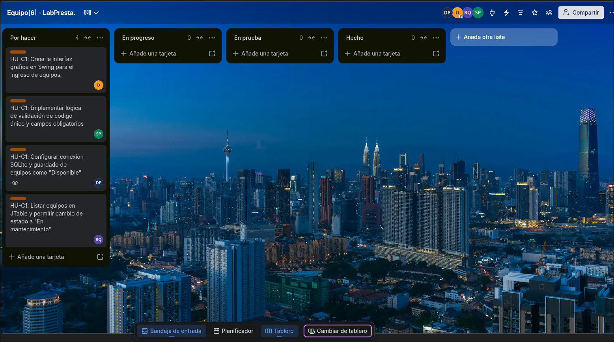

# LabPresta

Aplicación de escritorio desarrollada en **Java (Swing)** con persistencia en **SQLite (JDBC)** bajo la metodología **Scrum**, correspondiente al **Escenario C**.
El proyeto esta construido en **JDK17**

## 👥 Equipo y Roles Scrum
* **Product Owner:** [Santiago Paz]
* **Scrum Master:** [Diego Villagomez]
* **Desarrolladores:** [Danny Ponce], [Richard Quintana], [Diego Villagomez], [Santiago Paz]
* **Tablero Trello:** [https://trello.com/invite/b/6af88e86e57621a956ceb74f/ATTI79e72c285c7cdba2775f0913ba6582d931D728BF/equipo6-labpresta]

---

## 📁 Estructura del Proyecto

El código está organizado siguiendo una arquitectura por capas dentro de `src/com/labpresta/` para separar la interfaz gráfica de la lógica de negocio y la base de datos:

```text
labPresta-equipo6/
├── datos/                     # Base de datos SQLite para pruebas locales durante el desarrollo
│   └── labpresta.db
├── dist/                      # Carpeta de entrega final (ejecutable y datos precargados)
│   ├── LabPresta.jar
│   └── datos/
│       └── labpresta.db
├── lib/                       # Librerías externas permitidas
│   └── sqlite-jdbc-3.54.1.0.jar
└── src/
    └── com/
        └── labpresta/
            ├── Main.java          # Punto de entrada que inicia la aplicación
            ├── modelo/            # Clases entidad (POJOs): Equipo.java, Usuario.java, Prestamo.java
            ├── persistencia/      # Conexión SQLite y consultas SQL (DAOs): ConexionDB.java, EquipoDAO.java, etc.
            ├── logica/            # Validaciones y reglas de negocio: EquipoService.java, PrestamoService.java, etc.
            └── vista/             # Pantallas y formularios en Java Swing: VentanaPrincipal.java, PanelEquipos.java, etc.
```

## 📊 Seguimiento de Sprints

### Sprint 1 (Del Domingo 15 de Noviembre al Miercoles 18 de Noviembre)
* **Objetivo:** Implementar la arquitectura base, conexión a SQLite y el módulo completo de registro y gestión de equipos (`HU-C1`).

**Planificación inicial (Trello):**

  
  
  Asignación de tareas a cada miembro del scrum team

#### 🗓️ Bitácora Daily Scrum — Sprint 1

* **Día 1 — Domingo 15 de Noviembre**
  * **DP (Persistencia):** Creé la estructura del proyecto, configuré SQLite (`ConexionDB.java`), implementé `EquipoDAO.java` y actualicé el `README.md` con la planificación inicial. *Bloqueos:* Ninguno.
  * **D (Vista):** Creé la interfaz gráfica (FrmRegistroEquipo.java), la integré en el Main.java reemplazando la ventana de prueba, configuré el tablero de Trello con las listas requeridas y realicé el commit inicial de la historia HU-C1 en GitHub. *Bloqueos:* Ninguno.
  * **SP (Lógica):** 
  * **RQ (Vista/Persistencia):**

* **Entregables completados:**

